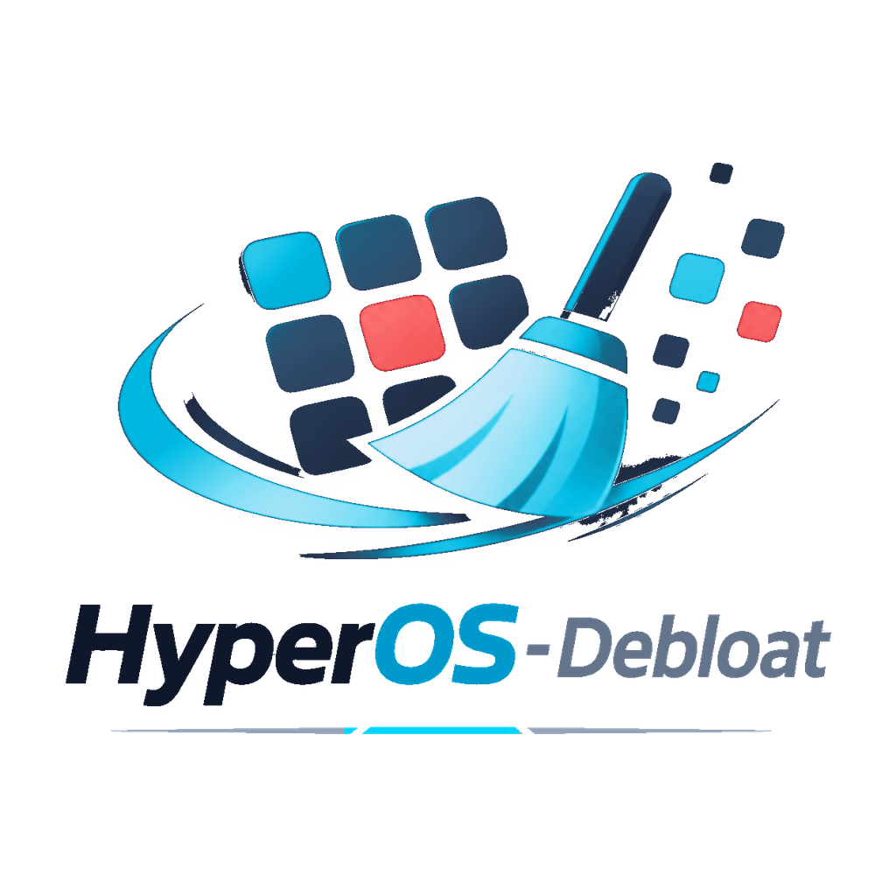

  <picture>
    <source media="(prefers-color-scheme: dark)" srcset="src/assets/logo/logo-lockup-1024.png">
    <source media="(prefers-color-scheme: light)" srcset="src/assets/logo/logo-lockup-light-1024.png">
    
  </picture>

  
  
  
  
  
  

<h1 align="center">HyperOS-Debloat</h1>

  HyperOS 3 / 4 通用精简模块 · 4 种精简模式 · WebUI 可视化管理 
  安全移除不必要的系统应用，把系统还给用户。

  <a href="#特性">特性</a> ·
  <a href="#兼容性">兼容性</a> ·
  <a href="#精简模式">精简模式</a> ·
  <a href="#安装">安装</a> ·
  <a href="#webui-管理">WebUI</a> ·
  <a href="#卸载与恢复">卸载与恢复</a> ·
  <a href="#常见问题">常见问题</a>

---

## 特性

| 能力 | 说明 |
| --- | --- |
| 4 种精简模式 | 快速 / 标准 / 深度 / 自定义，按力度逐级递进 |
| 68 个内置应用 | 广告追踪、游戏中心、云服务、AI、内容工具、系统服务、无障碍等分组管理 |
| WebUI 管理 | 搜索应用名或包名、分组折叠、暗色/亮色主题、逐项开关 |
| 危险项二次确认 | NFC、输入法、紧急警报等高风险组件精简前弹窗确认 |
| 自定义精简 | 设置中开启后可添加任意系统应用，走遮蔽优先 + pm 兜底双通路 |
| 配置保留 | 覆盖安装自动继承已有配置，无需重新选择 |
| 幂等执行 | 配置变化检测，重启后不会重复卸载 |
| 紧急恢复 | 配套清理包，应对卡米 / 卡锁屏 |
| 调试日志 | 可选开启，便于排查问题 |

## 兼容性

| 项目 | 支持情况 |
| --- | --- |
| 系统 | HyperOS 3 / HyperOS 4 |
| 框架 | Magisk 20.4+ / KernelSU |
| 元模块 | magic_mount_rs（推荐）/ mountify / Hybrid Mount / NoMount，KernelSU 用户需安装其一 |

> KernelSU 本身不提供模块文件挂载能力，需借助元模块完成遮蔽；Magisk 可直接使用。

## 精简模式

| 模式 | 力度 | 适合人群 | 主要内容 |
| --- | --- | --- | --- |
| 快速精简（推荐） | 轻 | 大部分用户，日常功能不受影响 | 广告追踪 + 游戏中心 |
| 标准精简 | 中 | 不用小米云服务、跨设备互联的用户 | 快速精简 + 设备互联 / 生态 |
| 深度精简 | 重 | 追求极致精简的用户 | 标准精简 + AI / 内容工具 / 系统服务 / 无障碍 |
| 自定义模式 | 自选 | 需要精确控制的用户 | 分组逐个选择，粒度最细 |

### 模式 1：快速精简（推荐）

精简广告追踪与游戏中心，保留所有核心功能。

- 广告追踪：智能服务（MSA）、安全追踪服务、AnalyticsCore、广告隐私权（apex）
- 游戏中心：游戏服务SDK、小游戏服务、游戏中心、游戏高能时刻

### 模式 2：标准精简

在快速精简基础上，额外精简设备互联 / 生态相关。

- 设备互联 / 生态：小米云服务、小米云同步、小米云备份、小米妙享、小米汽车互联、小米汽车互联服务、互联互通、互联通信服务、数字钥匙、骑行模式

### 模式 3：深度精简

在标准精简基础上，额外精简 AI / 小爱、内容 / 工具 / 安全、系统服务、无障碍 / 宏。可能影响部分系统功能。

- AI / 小爱：小爱推荐、超级小爱、语音唤醒、小爱视觉翻译、小爱服务、澎湃AI引擎
- 内容 / 工具 / 安全：智能助理、弹幕通知、传送门、用户反馈、黄页、三方应用异常分析、应用扩展服务、悬浮球
- 系统服务：下载管理、扫一扫、系统打印服务、打印处理服务、工作设置、窗口管理、UI信息工具、运营商服务、注册服务、系统质量监测、系统质量服务、MConnService、急救信息、功耗分析、系统助手、SystemHelper、健康数据共享（apex）、全局搜索、SIM卡应用、运营商通知、通话记录备份、日志抓取、触摸轨迹服务
- 无障碍 / 宏：开关控制、自动连招、GPU驱动更新

### 模式 4：自定义模式

每组功能单独选择，自由度最高。

1. 选择自定义模式
2. 逐个分组选择：音量+ 精简此组，音量- 进入分组
3. 进入分组后逐个应用选择：音量+ 精简，音量- 保留
4. 最后确认精简列表

| 分组 | 包含应用 |
| --- | --- |
| AI / 小爱 | 小爱推荐、超级小爱、语音唤醒、小爱视觉翻译、小爱服务、澎湃AI引擎 |
| 游戏中心 | 游戏服务、小游戏服务、游戏中心、游戏高能时刻 |
| 设备互联 / 生态 | 小米云服务、小米云同步、小米云备份、小米妙享、小米汽车互联、小米汽车互联服务、互联互通、互联通信服务、数字钥匙、骑行模式 |
| 广告 / 追踪 | 智能服务（MSA）、安全追踪服务、AnalyticsCore、广告隐私权（apex） |
| 内容 / 工具 / 安全 | 智能助理、弹幕通知、传送门、用户反馈、黄页、三方应用异常分析、应用扩展服务、悬浮球 |
| 系统服务 | 下载管理、扫一扫、系统打印服务、打印处理服务、工作设置、窗口管理、UI信息工具、运营商服务、注册服务、系统质量监测、系统质量服务、MConnService、急救信息、功耗分析、系统助手、SystemHelper、健康数据共享（apex）、全局搜索、SIM卡应用、运营商通知、通话记录备份、日志抓取、触摸轨迹服务 |
| 无障碍 / 宏 | 开关控制、自动连招、GPU驱动更新 |

## 危险项

选择模式后会额外询问以下危险项，可跳过：

| 危险项 | 风险 |
| --- | --- |
| NFC 服务 | 门禁 / 公交卡 / 付款可能失效 |
| 系统安全组件 | 可能影响应用兼容性 |
| 搜狗输入法小米版 | 请确保已安装其他输入法 |
| 讯飞输入法 | 请确保已安装其他输入法 |
| Cell Broadcast Service（紧急警报） | 精简后收不到地震 / 灾害预警 |
| 小米智能卡网页组件 | NFC 核心组件，门禁 / 公交卡 / 付款全部失效 |
| 小米智能卡 | NFC 核心组件，门禁 / 公交卡 / 付款全部失效 |
| 米币支付 | 米币相关功能失效 |
| 应用商店 | 无法通过官方商店下载应用 |

## 安装

1. 从 [Releases](https://github.com/wenrouhao/HyperOS-Debloat/releases) 下载最新 ZIP
2. 打开 KernelSU / Magisk 管理器 → 模块 → 从本地安装 → 选择 ZIP
3. 等待安装完成，**不要重启**
4. 按屏幕提示用音量键选择模式
5. 操作完成后重启

### 按键操作

| 按键 | 作用 |
| --- | --- |
| 音量+ | 确认当前选项 |
| 音量- | 切换到下一个选项 |

选项循环显示：`1 → 2 → 3 → 4 → 1 …`

> **从 v4.x 升级**：模块 id 已改为 `HyperOS_Debloat`。安装新版会自动调用旧版卸载逻辑（恢复已精简应用）并移除旧模块；若提示无法移除，请先在管理器中卸载旧版再安装。

## WebUI 管理

重启后在 KernelSU 管理器中打开模块，点击 WebUI：

- 搜索应用名或包名
- 暗色 / 亮色主题切换（跟随系统或手动）
- 逐个应用开关精简
- 危险项开启时弹出警告确认
- 保存或保存并重启生效
- 设置：自定义精简应用、调试日志

### 自定义精简应用

1. 点击右上角设置进入
2. 开启"自定义精简应用"（首次开启需确认免责声明）
3. 底部出现"增加应用"按钮
4. 选择要精简的应用
5. 保存或保存并重启生效

> 自定义精简属于高级功能，操作不当可能影响系统稳定性。建议先备份数据，风险由用户自行承担。

## 卸载与恢复

> [!WARNING]
> 请勿在 recovery 或文件管理器中直接删除模块目录。模块记录了已精简应用的卸载状态，只有管理器卸载才会触发恢复逻辑；直接删除不会恢复系统应用，可能卡激活界面或功能缺失。

正确做法二选一：

- 通过 KernelSU / Magisk 管理器卸载模块；
- 或在 WebUI 中关闭对应开关，保存后重启。

如果已经在 recovery 删除过模块：重新安装模块 → 打开 WebUI 关闭所有开关 → 保存并重启；或执行 `pm install-existing --user 0 <包名>` 手动恢复。

### 卡米 / 卡锁屏紧急恢复

**有第三方 Recovery（TWRP）**

下载 Release 中的 `HyperOS-Debloat-cleanup.zip` 刷入，清理包会：

- 删除模块目录，解除所有应用遮蔽
- 尝试恢复被卸载的应用
- 若 TWRP 不支持 pm，则清除应用限制配置，重启后由系统重建

**无第三方 Recovery**

- KernelSU：开机按住音量下键进入安全模式，所有模块禁用，进系统后在管理器卸载
- Magisk：开机通过音量键组合进入核心模式，进系统后在管理器卸载
- 能进 fastboot 时，可用 `fastboot boot` 临时启动 TWRP 镜像后刷入清理包

> 模块对系统分区（`/product`、`/system`）的应用仅做目录遮蔽，不执行 pm 卸载，因此多数情况删除模块目录即可完整恢复；只有物理位于 `/data/app/` 下的应用（出厂预装或用户更新过）才会被 pm 卸载，需要清理包恢复。

## 常见问题

**精简后还能恢复吗？**
可以。通过管理器卸载模块，或在 WebUI 关闭开关后保存并重启即可恢复。

**覆盖安装会丢失配置吗？**
不会，安装流程会自动保留已有配置并继续生效。

**精简后开机卡米 / 卡锁屏怎么办？**
刷入 Release 中的清理包；没有第三方 Recovery 时，按上方对应框架的安全模式步骤操作。

**为什么 KernelSU 需要元模块？**
KernelSU 自身不提供模块文件挂载，需要 magic_mount_rs / mountify 等元模块承载遮蔽；Magisk 可直接使用。

**模块适配哪些机型？**
适配针对 HyperOS 3 / 4 的系统组件，不绑定具体机型；精简清单以小米系统应用为准。

## 更新

v5.x 之间可直接覆盖刷入，无需卸载旧版；从 v4.x 升级请按安装章节的说明先卸载旧版。

## 反馈

遇到问题或有精简建议，欢迎在 [Issues](https://github.com/wenrouhao/HyperOS-Debloat/issues) 反馈，附上系统版本、模式选择与模块日志，便于定位。

## 免责声明

本模块仅供学习和研究使用。使用本模块可能造成系统不稳定、数据丢失、设备损坏或功能异常，**作者概不负责**。使用前请备份重要数据，风险自负。

  <picture>
    <source media="(prefers-color-scheme: dark)" srcset="src/assets/logo/logo-wordmark-1024.png">
    <source media="(prefers-color-scheme: light)" srcset="src/assets/logo/logo-wordmark-light-1024.png">
    
  </picture>

HyperOS-Debloat · 温柔浩

